<div align="center">



### Making production boring. Making engineering interesting.

Cloud SME at **Amazon** · India · AWS / GCP / DevOps

[](https://linkedin.com/in/prasant-jakhar/)
[](https://jakharprasant.hashnode.dev)
[](https://twitter.com/Prasantjakha17)

[About](#about) &nbsp; / &nbsp; [Projects](#projects) &nbsp; / &nbsp; [Toolkit](#toolkit) &nbsp; / &nbsp; [Credentials](#credentials) &nbsp; / &nbsp; [Activity](#activity)

</div>

---

## About

```console
prasant@cloud:~$ whoami
Cloud engineer. Infrastructure builder. YAML enthusiast.

prasant@cloud:~$ cat philosophy.txt
The best infrastructure is the kind nobody notices — because it just works.
```

I design systems that scale quietly, fail gracefully, and let teams sleep through the night. My work brings together **cloud architecture**, **infrastructure as code**, and **production reliability**.

<details>
<summary><b>Open my engineering playbook</b> — how I think about infrastructure</summary>

- **Automate the repeatable.** Put infrastructure in version control and make changes reproducible.
- **Design for failure.** Treat blast radius and recovery as architecture decisions.
- **Make systems explain themselves.** Connect metrics, logs, and traces before an incident.
- **Build security into delivery.** Give security checks a place in the pipeline.
- **Keep learning in public.** Turn experiments into projects and share what sticks.

</details>

## Projects

**Choose a route:** [Cloud & IaC](#cloud--iac) · [Containers & delivery](#containers--delivery) · [Observability & security](#observability--security)

### Cloud & IaC

<details open>
<summary><b>01 / Cloud Resume Challenge</b> — a serverless stack, from code to deployment</summary>

A resume hosted on AWS with infrastructure defined in Terraform and delivery automated with GitHub Actions.

```text
Visitor → CloudFront → S3
                API Gateway → Lambda → DynamoDB
Terraform + GitHub Actions → infrastructure & delivery
```

**Explore:** serverless architecture · infrastructure as code · CI/CD

[View the repository →](https://github.com/cyber-cl/cloud-resume-challenge)

</details>

### Containers & delivery

<details>
<summary><b>02 / EMart App</b> — microservices on Kubernetes</summary>

A full-stack e-commerce application containerized with Docker and orchestrated on Amazon EKS.

**Stack:** Docker · Kubernetes · AWS EKS

**Explore:** containerization · service orchestration · cloud deployment

[View the repository →](https://github.com/cyber-cl/emartapp)

</details>

<details>
<summary><b>03 / Netflix Clone</b> — from commit to a monitored deployment</summary>

A Netflix UI clone with a delivery pipeline and monitoring stack.

**Stack:** Jenkins · Docker · Kubernetes · Prometheus · Grafana

**Explore:** CI/CD pipelines · container deployments · operational visibility

[View the repository →](https://github.com/cyber-cl/Netflix-Clone-using-Kubernetes-Cluster)

</details>

### Observability & security

<details>
<summary><b>04 / OpenTelemetry Astronomy Shop</b> — follow a request across services</summary>

A cloud-native microservices demo instrumented with OpenTelemetry for distributed traces, metrics, and logs.

**Stack:** OpenTelemetry · microservices

**Explore:** distributed tracing · telemetry signals · service behavior

[View the repository →](https://github.com/cyber-cl/OpenTelemetry-Astronomy-Shop)

</details>

<details>
<summary><b>05 / Production Grade DevSecOps</b> — security checks in the delivery path</summary>

An end-to-end pipeline integrating static analysis, dynamic testing, container scanning, and security gates.

**Focus:** SAST · DAST · container scanning · CI/CD

**Explore:** shifting security left · automated checks · delivery gates

[View the repository →](https://github.com/cyber-cl/Production-Grade-End-to-End-DevSecOps-Project)

</details>

[Browse all repositories ↗](https://github.com/cyber-cl?tab=repositories) · [Discuss a project ↗](https://linkedin.com/in/prasant-jakhar/)

## Toolkit

<p align="center">
  
</p>

| Layer | Tools I work with |
| :--- | :--- |
| **Cloud** | AWS · Google Cloud · Azure |
| **Infrastructure** | Terraform · CloudFormation · Ansible |
| **Containers** | Docker · Kubernetes · ECS · Helm |
| **Delivery** | GitHub Actions · Jenkins · Argo CD · Git |
| **Observability** | OpenTelemetry · Prometheus · Grafana · Kibana · CloudWatch |
| **Networking & security** | VPC · Route 53 · CloudFront · IAM · KMS · Shield |
| **Languages & systems** | Python · Java · Bash · Linux · Windows |

## Credentials

<details>
<summary><b>5 cloud certifications</b> — expand the list</summary>

| Platform | Certification |
| :--- | :--- |
| AWS | Solutions Architect — Associate |
| AWS | CloudOps Engineer — Associate |
| AWS | Developer — Associate |
| AWS | Cloud Practitioner |
| Google Cloud | Associate Cloud Engineer |

</details>

## Activity

<div align="center">

**A little automation, a lot of little green squares.**

<!-- Generated by .github/workflows/contribution-snake.yml on the output branch. -->
<picture>
  <source media="(prefers-color-scheme: dark)" srcset="https://raw.githubusercontent.com/cyber-cl/cyber-cl/output/github-snake-dark.svg" />
  <source media="(prefers-color-scheme: light)" srcset="https://raw.githubusercontent.com/cyber-cl/cyber-cl/output/github-snake.svg" />
  
</picture>

[View contributions ↗](https://github.com/cyber-cl?tab=overview) · [Try the interactive snake demo ↗](https://platane.github.io/snk/)

<details>
<summary>Show the activity graph</summary>


</details>

</div>

---

<div align="center">

**Building something in the cloud? Let's compare notes.**

[Connect on LinkedIn](https://linkedin.com/in/prasant-jakhar/) · [Read the blog](https://jakharprasant.hashnode.dev) · [Back to top ↑](#)

<sub>Built with curiosity. Deployed with a plan. Observed in production.</sub>

</div>
